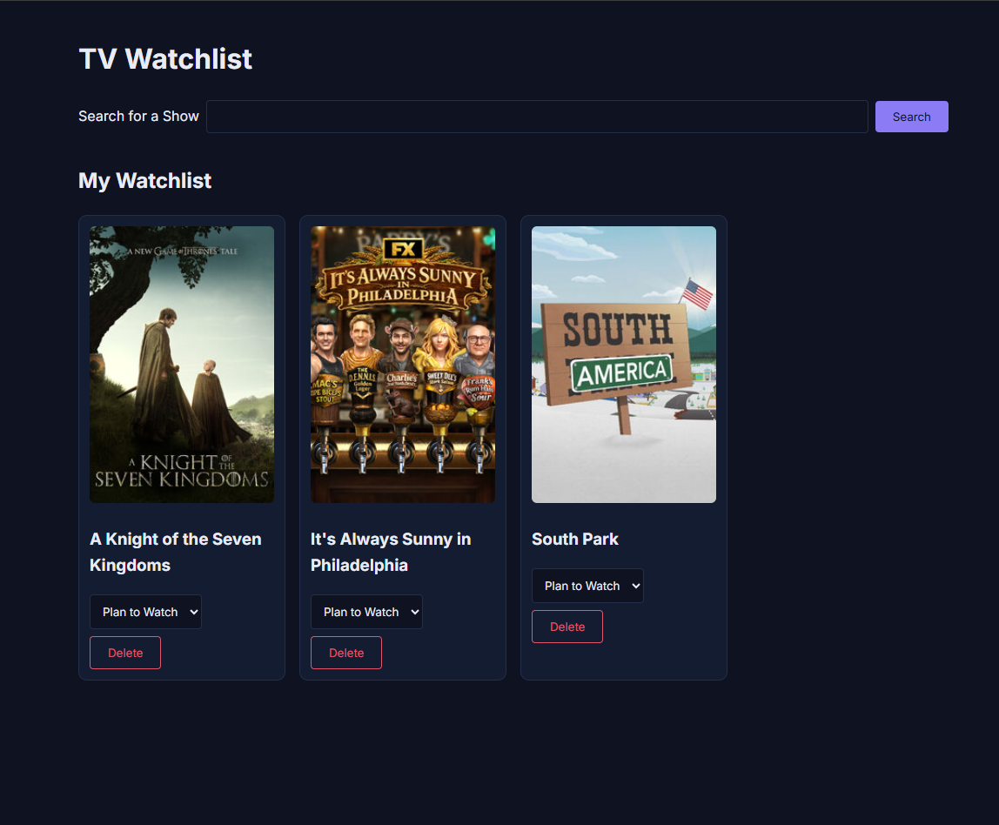

# TV Watchlist
This app allows users to search for television shows using the TVmaze API and allows them to save the shows to a watchlist.

[Live site](https://j-winchester94.github.io/tv-watchlist/)

## Features
- Uses local storage to save TV shows to a watchlist
- Page updates when user searches for and adds shows to their watchlist
- Asks users if they wish to delete a show from their list
- Users are able to update the status of the shows that they're watching to "Plan to Watch," "Watching," or "Finished."
- Loading and error messages
- Duplicate prevention
- Friendly empty states
- Responsive card grid

## Built with
- HTML5
- CSS
- React
- localStorage
- Vite
- [TVmaze API](https://www.tvmaze.com/api)

## What I learned
- How to fetch data in React
- How to handle nested API data
- How to handle loading and error states using try / catch
- How to render things conditionally with &&
- How to use empty states
- How to update one item in an array using map and the spread operator
- How to strip HTML from API text

## Future Improvements
- Sharing a watchlist with others
- Ability to sort by status of shows on watchlist, alphabetically, etc.
- Personal ratings and reviews for each show
- Ability to expand the cards of searched shows so that users can read the full summary